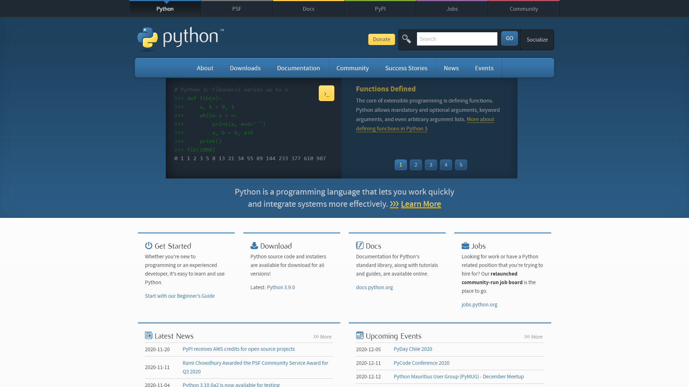
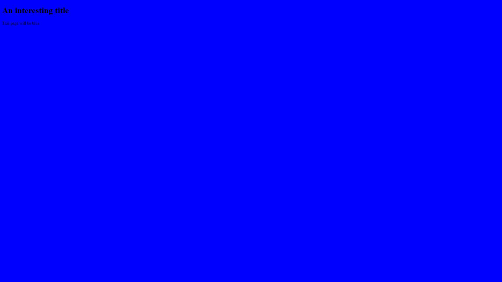

<h1 align="center">
  <a href="https://github.com/vgalin/html2image">
    
  </a>
</h1>


<div align="center">


|[PyPI Package](https://pypi.org/project/html2image/)|[GitHub Repository](https://github.com/vgalin/html2image)|
|-|-|

**A lightweight Python package acting as wrapper around the headless mode of existing web browsers, allowing image generation from HTML/CSS strings, files and URLs.**

</div>
&nbsp;

This package has been tested on Windows, Ubuntu (desktop and server) and MacOS. If you encounter any problems or difficulties while using it, feel free to open an issue on the GitHub page of this project. Feedback is also welcome!

⚠️ Disclaimer: Use this package with trusted content only. Processing untrusted or unsanitized input can lead to malicious code execution. Always ensure content safety.

## Principle


Most web browsers have a Headless Mode, which is a way to run them without displaying any graphical interface. Headless mode is mainly used for automated testing but also comes in handy if you want to take screenshots of web pages that are exact replicas of what you would see on your screen if you were using the browser yourself.

However, for the sake of taking screenshots, headless mode is not very convenient to use. HTML2Image aims to hide the inconveniences of the browsers' headless modes while adding useful features, such as allowing the creation of images from simple strings.

For more information about headless modes :
-   (Chrome) [https://developers.google.com/web/updates/2017/04/headless-chrome](https://developers.google.com/web/updates/2017/04/headless-chrome)
-   (Firefox) [https://developer.mozilla.org/en-US/docs/Mozilla/Firefox/Headless_mode](https://web.archive.org/web/20210604151145/https://developer.mozilla.org/en-US/docs/Mozilla/Firefox/Headless_mode)

## Installation
HTML2Image is published on PyPI and can be installed through `pip`:

```console
pip install --upgrade html2image
```

Or with `uv`:
```console
uv pip install html2image
```

Some full-page screenshots need the `pyvips` package to join several
screenshots into one image. The `full-page` extra will install it along with
html2image:

```console
pip install "html2image[full-page]"
```

It will be needed when a page taller than the window has a fixed or sticky
element, such as a header that stays at the top, as most websites do. It will
also be needed for pages taller than 16,000 px under Chrome and Edge, or
65,535 px under Firefox. Without it, these captures will raise an `ImportError`.

In addition to this package, at least one of the following browsers **must** be installed on your machine :
-   Google Chrome (Windows, MacOS)
-   Chromium Browser (Linux)
-   Microsoft Edge
-   Mozilla Firefox

## Usage

### First, import the package and instantiate it
```python
from html2image import Html2Image
hti = Html2Image()
```

Multiple arguments can be passed to the constructor:

-   `browser` : Browser used to take screenshots. Default is `'chrome'` (CDP backend). See the [Browser support](#browser-support) section below for all available values.
-   `browser_executable` : The path or the command that can be used to find the executable of a specific browser.
-   `output_path` : Path to the folder to which taken screenshots will be outputted. Default is the current working directory of your python program.
-   `size` : 2-Tuple representing the size of the screenshots that will be taken. Default value is `(1920, 1080)`.
-   `temp_path` : Path that will be used to put together different resources when screenshotting strings of files. Default value is `%TEMP%/html2image` on Windows, and `/tmp/html2image` on Linux and MacOS.
-   `keep_temp_files` : Pass True to this argument to not automatically remove temporary files created in `temp_path`. Default is False.
-   `disable_logging` : Suppress stdout/stderr logs generated in the console by underlying browsers. 
-   `allow_scripts_to_read_files` : Lets JavaScript in your HTML read other files from your disk. Off by default, as most pages don't need it. Read [Reading local files from JavaScript](#reading-local-files-from-javascript) before turning it on.
-   `add_doctype` : Start the pages built from `html_str` with `<!DOCTYPE html>`, so that browsers render them like any modern web page. html2image 2.x left it out, and browsers then fell back to an old compatibility mode. If your screenshots look different since version 3.0, pass False to get the old rendering back. Default is True.
-   `max_concurrency` : Maximum number of screenshots or PDFs that can be made at the same time, from several threads. Only works with the `chrome`, `edge` and `firefox` browsers, inside a `with` block. Default is 1. See [Taking screenshots at the same time](#taking-screenshots-at-the-same-time).
-   `isolate_pages` : Capture each page as if it were opened in a new private window, so that it will not see the cookies, cache or other data left by the other pages. Pass False to let the pages share them, which is a little faster, especially for pages of the same site. False only works with the `chrome`, `edge` and `firefox` browsers. Default is True. See [Sharing cookies and cache between pages](#sharing-cookies-and-cache-between-pages).

Example:
```python
hti = Html2Image(size=(500, 200))
```

You can also change these values later: 
``` python
hti.size = (500, 200)
```

### Then take a screenshot

The `screenshot` method is the basis of this package. Most of the time, you won't need to use anything else. It can take screenshots of various things:
- URLs via the `url` parameter;
- HTML and CSS **files** via the `html_file` and `css_file` parameters;
- HTML and CSS **strings** via the `html_str` and `css_str` parameters;
- and "other" types of files via the `other_file` parameter (try it with .svg files!).

And you can also (optional):
- Change the size of the screenshots using the `size` parameter;
- Save the screenshots as a specific name using the `save_as` parameter.

*N.B.: The `screenshot` method returns a **list** containing the path(s) of the screenshot(s) it took.*

### A few examples

- **URL to image**
```python
hti.screenshot(url='https://www.python.org', save_as='python_org.png')
```

- **HTML & CSS strings to image**
```python
html = """<h1> An interesting title </h1> This page will be red"""
css = "body {background: red;}"

hti.screenshot(html_str=html, css_str=css, save_as='red_page.png')
```

- **HTML & CSS files to image**
```python
hti.screenshot(
    html_file='blue_page.html', css_file='blue_background.css',
    save_as='blue_page.png'
)
```

- **Other files to image**
```python
hti.screenshot(other_file='star.svg')
```

- **Change the screenshots' size**
```python
hti.screenshot(other_file='star.svg', size=(500, 500))
```

### Full-page screenshots

The `chrome`, `chromium`, `edge` and `firefox` browsers can capture the whole
page instead of stopping at the bottom of the window:

```python
hti.screenshot(
    url='https://www.python.org',
    save_as='python_org_full.png',
    size=(1280, 720),
    full_page=True,
)
```

With `full_page=True`, the image will be as wide as `size`, and as high as the
page, but not less than the height of `size`. That height will be the height of
the window, which changes how some pages look, for example a first section that
fills the window.

`full_page_profile` sets how long to wait for the content that loads as the page
is scrolled:

- `fast` will not wait for it. It is the default for pages given as HTML or as a
  file. Images in `loading="lazy"` may then be missing.
- `balanced` will wait until the height of the page stops changing, then scroll
  through it once. It is the default for URLs.
- `robust` will scroll through the page until it stops growing. It is the
  slowest.

`full_page_stability_timeout` is the longest wait, in seconds, each time the
height of the page has to stop changing, not for the whole capture. `fast` does
not use it.

Some elements stay in place while the page scrolls, such as a header fixed at
the top of the window. `full_page_fixed_elements` sets how they will appear in
the image:

- `auto` (default): each one will appear once, at the top or at the bottom of
  the image, depending on where it is fixed in the window.
- `first`: they will appear once, as they are when the page is opened.
- `last`: they will appear once, as they are when the page is scrolled to the
  end.
- `hide`: they will not appear.
- `preserve`: they will be left as the browser shows them, and can appear
  several times in the image.

Sticky elements will stay in their place in the page, except with `preserve`.

`full_page_max_pixels` limits the image to 100,000,000 pixels by default, and
`None` removes the limit, which can use a lot of memory. A larger page, or a
JPEG image wider or higher than 65,500 px, will raise `CaptureTooLargeError`
instead of giving a cut image.

A `FullPageWarning` will be given when an image was saved but may be wrong in
places, for example if the page moved while it was captured, or when the image
stops before the end of the page. An endless feed, which keeps loading content
as it is scrolled, will stop at a limit, at least twice the height it had when
the capture started.

---

<details>
<summary> Click to show all the images generated with all the code above </summary>





</details>


---

- **Change the directory to which the screenshots are saved**
```python
hti = Html2Image(output_path='my_screenshot_folder')
```
**OR**
```python
hti.output_path = 'my_screenshot_folder'
```

*N.B. : the output path will be changed for all future screenshots.*

---

#### Use lists in place of any parameters while using the `screenshot` method
- Screenshot multiple objects using only one filename, or one filename per file:
```python
# create three files from one filename
hti.screenshot(html_str=['A', 'B', 'C'], save_as='ABC.png')
# outputs ABC_0.png, ABC_1.png, ABC_2.png

# create three files from from different filenames
hti.screenshot(html_str=['A', 'B', 'C'], save_as=['A.png', 'B.png', 'C.png'])
# outputs A.png, B.png, C.png
```
- Take multiple screenshots with the same size
```python
# take four screenshots with a resolution of 100*50
hti.screenshot(
    html_str=['A', 'B', 'C', 'D'],
    size=(100, 50)
)
```
- Take multiple screenshots with different sizes
```python
# take four screenshots with different resolutions from three given sizes
hti.screenshot(
    html_str=['A', 'B', 'C', 'D'],
    size=[(100, 50), (100, 100), (50, 50)]
)
# respectively 100*50, 100*100, 50*50, 50*50
# if not enough sizes are given, the last size in the list will be repeated

```

- Apply CSS string(s) to multiple HTML string(s)
```python
# screenshot two html strings and apply css strings on both
hti.screenshot(
    html_str=['A', 'B'],
    css_str='body {background: red;}'
)

# screenshot two html strings and apply multiple css strings on both
hti.screenshot(
    html_str=['A', 'B'],
    css_str=['body {background: red;}', 'body {font-size: 50px;}']
)

# screenshot one html string and apply multiple css strings on it
hti.screenshot(
    html_str='A',
    css_str=['body {background: red;}', 'body {font-size: 50px;}']
)
```

---

- **Retrieve the path of the generated file(s)**  
The `screenshot` method returns a list containing the path(s) of the screenshot(s):

```python
paths = hti.screenshot(
    html_str=['A', 'B', 'C'],
    save_as="letters.png",
)

print(paths)
# >>> ['D:\\myFiles\\letters_0.png', 'D:\\myFiles\\letters_1.png', 'D:\\myFiles\\letters_2.png']
```

---

#### Change browser flags
In some cases, you may need to change the *flags* that are used to run the headless mode of a browser.

Flags can be used to:
- Change the default background color of the pages;
- Hide the scrollbar;
- Add delay before taking a screenshot;
- Allow you to use Html2Image when you're root, as you will have to specify the `--no-sandbox` flag;

You can find the full list of Chrome / Chromium flags [here](https://peter.sh/experiments/chromium-command-line-switches/).

There are two ways to specify custom flags:
```python
# At the object instanciation
hti = Html2image(custom_flags=['--my_flag', '--my_other_flag=value'])

# Afterwards
hti.browser.flags = ['--my_flag', '--my_other_flag=value']
```

- **Flags example use-case: adding a delay before taking a screenshot**

With Chrome / Chromium, screenshots are fired directly after there is no more "pending network fetches", but you may sometimes want to add a delay before taking a screenshot, to wait for animations to end for example. 
There is a flag for this purpose, `--virtual-time-budget=VALUE_IN_MILLISECONDS`. You can use it like so:

```python
hti = Html2Image(
    custom_flags=['--virtual-time-budget=10000', '--hide-scrollbars']
)

hti.screenshot(url='http://example.org')
```

The CDP backends (`chrome`, `edge`) do not pass this flag to the browser: once the page is loaded, they let it run for the given amount of virtual time through the protocol, then take the screenshot. The legacy CLI backends (`chrome-headless`, `edge-headless`) pass the flag to the browser as is. This flag has no effect with Firefox.

- **Default flags**

For ease of use, some flags are set by default. However default flags are not used if you decide to specify `custom_flags` or change the value of `browser.flags`:

```python
# Taking a look at the default flags (default Chrome/CDP backend)
>>> hti = Html2Image()
>>> hti.browser.flags
['--hide-scrollbars']

# Legacy Chrome CLI backend
>>> legacy = Html2Image(browser='chrome-headless')
>>> legacy.browser.flags
['--default-background-color=00000000', '--hide-scrollbars', '--force-device-scale-factor=1']

# Changing the value of browser.flags gets rid of the default flags.
>>> hti.browser.flags = ['--1', '--2']
>>> hti.browser.flags
['--1', '--2'] 

# Using the custom_flags parameter gets rid of the default flags.
>>> hti = Html2Image(custom_flags=['--a', '--b'])
>>> hti.browser.flags
['--a', '--b']
```

### Capturing a single element from a page

Give a CSS selector to `screenshot()` to save an image of one element instead of the whole window:

```python
hti.screenshot(url='https://example.org/', selector='#card', save_as='card.png')
```

The generated image will have the size of the element, even if the element is larger than the window or further down the page. If several elements match, the first one will be used, as with `document.querySelector()` in JavaScript.

With a list of selectors, one image will be saved per selector, for each page. Each page will only be loaded once, and each image will be the same as with one call per selector, unless the page changes when it is resized (see the limits below):

```python
hti.screenshot(
    html_str=html,
    selector=['#chart', '#table'],
    selector_padding=16,
    save_as=['chart.png', 'table.png'],
)
```

`selector_padding` adds pixels around the element, to include its shadow for example. The padding will stop at the edges of the page.

Give one name per image in `save_as`, and one size per page in `size`: the size sets the window in which the page will be laid out.

Limits:

- `selector` only works with the `chrome`, `edge` and `firefox` browsers, not with `chrome-headless`, `edge-headless` or `firefox-headless`.
- Chrome and Edge can capture at most 16384 pixels in width and in height, Firefox at most 65535.
- On a page without `<!DOCTYPE html>`, Firefox may only be able to capture an element that fits in the window. Pages built from `html_str` get a doctype, unless `add_doctype=False` is given.
- An element inside an `<iframe>` or a shadow DOM will not be found.
- An element added by a script after the page has loaded may not be found. With Chrome and Edge, the `--virtual-time-budget` flag described in "Change browser flags" will let the page run its scripts before the capture.
- An element hidden with `visibility: hidden` still has a size: the image will show what is behind it.
- With Chrome and Edge, an element that is not entirely shown in the window once the page is loaded, with its padding, will be captured beyond the window. The browser will then tell the page that the window was resized (a `resize` event), although the window will keep its size. A page that changes when it is resized may look changed in this image and in the next images of the same call. Firefox will not do this.

If an element has nothing to capture (no element matches the selector, or it is hidden, empty or outside of the page), `ElementNotFoundError` will be raised once all the other images have been saved. Pass `skip_missing=True` to skip such elements instead: the returned list will then only contain the saved images.

```python
from html2image import Html2Image, ElementNotFoundError

try:
    hti.screenshot(url=urls, selector='#price', save_as='price.png')
except ElementNotFoundError as error:
    print('Saved:', error.paths)
    for selector, filename in error.missing:
        print(f'No {selector} for {filename}')
```

An element too large for the browser will raise `CaptureTooLargeError`, even with `skip_missing=True`. This error will also be raised once all the other images have been saved.

### Save pages as PDF

The `pdf()` method saves pages as PDF files instead of images. It takes the same sources as the `screenshot()` method (`url`, `html_file`, `css_file`, `html_str`, `css_str`, `other_file`) and the same `save_as`, and also returns a list of paths.

```python
hti.pdf(url='https://www.python.org', save_as='python_org.pdf')

hti.pdf(
    html_str='<h1>Invoice</h1><p>Thank you for your order.</p>',
    css_str='h1 { color: navy; }',
    save_as='invoice.pdf',
)
```

The page is printed, as with the "Save as PDF" option of your browser: the content is laid out for paper and split into pages, the text stays selectable and the links stay clickable. Because of this, a PDF does not always look like the screenshot of the same page: styles written for printing (`@media print`) apply, and the width of the paper replaces the width of the window, so there is no `size` parameter.

You can choose the paper and its margins:

```python
hti.pdf(url='https://www.python.org', save_as='python_org.pdf',
        paper_size='Letter', landscape=True, margin='1.5cm')

hti.pdf(html_file='label.html', save_as='label.pdf',
        paper_size=('10cm', '15cm'), margin='5mm 1cm')
```

| Parameter | Default | Description |
|---|---|---|
| `paper_size` | `'A4'` | `'A3'`, `'A4'`, `'A5'`, `'Letter'`, `'Legal'`, `'Tabloid'`, `'slide'` (16:9, 1280 × 720 px), or a `(width, height)` pair |
| `landscape` | `None` | `True` for sideways paper, `False` for upright paper, `None` to keep the orientation of `paper_size` |
| `margin` | `'1cm'` (`'0'` for `'slide'`) | written like the CSS `margin` property: 1 to 4 lengths |
| `background` | `True` | print background colors and images |
| `scale` | `1` | zoom of the content, from 0.1 to 2 |

Lengths are written as in CSS, with a unit: `mm`, `cm`, `Q`, `in`, `pt`, `pc` or `px` (1px is 1/96 of an inch). Only `0` can be written without a unit.

If your page sets its own paper size or margins with a CSS `@page` rule, they take precedence over `paper_size` and `margin`.

**Slides.** To turn HTML slides into a PDF, make each slide 1280 × 720 px and start a new page after each one:

```python
css = """
body { margin: 0; }
section { width: 1280px; height: 720px; break-after: page; }
"""
html = '<section>First slide</section><section>Second slide</section>'

hti.pdf(html_str=html, css_str=css, save_as='slides.pdf', paper_size='slide')
```

*N.B.:*
- *The `pdf()` method works with the `chrome` (default), `edge` and `firefox` browsers. It does not work with the legacy `chrome-headless`, `edge-headless` and `firefox-headless` browsers, which can only take screenshots: with them, `pdf()` raises a `ValueError` and creates no file.*
- *Chrome and Firefox do not lay out a page in exactly the same way, so their PDFs of the same page can differ, for example in the number of pages. Firefox is also slower: a few seconds per PDF.*
- *The `screenshot()` method refuses file names ending in `.pdf`: use the `pdf()` method instead.*

### Browser support

| Browser | Aliases | Protocol | PNG | JPEG | PDF | SVG transparency | Exact viewport |
|---------|---------|----------|:---:|:----:|:---:|:----------------:|:--------------:|
| Chrome | `chrome`, `chrome-cdp`, `chromium`, `chromium-cdp`, `google-chrome` | CDP | ✓ | ✓ | ✓ | ✓ | ✓ |
| Chrome (legacy) | `chrome-headless` | CLI | ✓ | ✓ | ✗ | ✓ | ~ |
| Edge | `edge`, `edge-cdp` | CDP | ✓ | ✓ | ✓ | ✓ | ✓ |
| Edge (legacy) | `edge-headless` | CLI | ✓ | ✓ | ✗ | ✓ | ~ |
| Firefox | `firefox`, `mozilla-firefox`, `firefox-bidi` | BiDi | ✓ | ✓ | ✓ | ⚠ | ✓ |
| Firefox (legacy) | `firefox-headless` | CLI | ✓ | ✗ | ✗ | ⚠ | ~ |

**Legend:**
- ✓ supported
- ✗ not supported
- ~ approximate (CLI headless may add an unwanted strip on some layouts)
- ⚠ known limitation: transparent backgrounds in standalone SVG files are rendered as opaque white

Chrome CDP is currently the default backend.

CDP and BiDi backends choose a free debugging port automatically. They also
accept a `browser_cdp_port` / `browser_bidi_port` parameter when a fixed port
is required:

```python
# Fix the CDP port for Chrome or Edge
hti = Html2Image(browser='chrome', browser_cdp_port=9222)

# Fix the BiDi port for Firefox
hti = Html2Image(browser='firefox', browser_bidi_port=9333)
```

### Taking screenshots at the same time

`max_concurrency` lets several threads take screenshots or save PDFs at the same time with one `Html2Image` object. The browser will open that many windows. Each screenshot or PDF will use a free window, or wait for one.

```python
from concurrent.futures import ThreadPoolExecutor
from html2image import Html2Image

pages = {
    'python_org.png': 'https://www.python.org',
    'pypi_org.png': 'https://pypi.org',
    'w3_org.png': 'https://www.w3.org',
}

with Html2Image(max_concurrency=3) as hti:
    with ThreadPoolExecutor(3) as executor:
        futures = [
            executor.submit(hti.screenshot, url=url, save_as=name)
            for name, url in pages.items()
        ]
    results = [future.result() for future in futures]
```

- *It only works with the `chrome` (default), `edge` and `firefox` browsers. Any other browser raises a `ValueError` if `max_concurrency` is not 1.*
- *It only has an effect inside a `with` block. Outside one, the screenshots will be taken one after the other.*
- *A list given to a single call will still be captured one page after the other. Make one call per page instead.*
- *Give each screenshot its own `save_as` name, or they will overwrite each other.*
- *Do not use two different `css_file` with the same file name at the same time. Pages will load a style sheet by its name, so one page could get the other's.*
- *Separate processes, such as two programs or the workers of a web server, should each use their own `temp_path`. Screenshots of one process will never share a temporary page, but those of two processes could.*
- *By default, pages captured at the same time will not share cookies or cache. See [Sharing cookies and cache between pages](#sharing-cookies-and-cache-between-pages).*
- *If a page blocks its window, for example with a script that never ends, its screenshot will fail and the window will be replaced. The other screenshots will go on.*
- *If the browser itself stops, for example after a crash, the screenshots in progress will fail and the next ones will use a new browser.*
- *Leaving the `with` block will close the browser at once. Screenshots still in progress in other threads will fail with `BrowserError`.*

### Sharing cookies and cache between pages

By default, each page will be captured as if it were opened in a new private window. It will not see the cookies, cache or other data left by the other pages, so what one page leaves in the browser will not change the screenshot of another.

With `isolate_pages=False`, the pages will share the cookies, cache and other data of the browser, as if you opened them one after the other in the same tab. This will be the case for the pages of a list given to one `screenshot()` or `pdf()` call, and for all the pages captured in the same `with` block. Outside a `with` block, the browser will be closed at the end of each call, so a call will share nothing with the earlier ones.

Sharing the cache can be faster when you capture several pages of the same site: the files they have in common, such as fonts, style sheets and images, can be taken from the cache instead of being downloaded again. For example, these three pages of the same site will share their cache:

```python
hti = Html2Image(isolate_pages=False)
hti.screenshot(
    url=[
        'https://example.com/',
        'https://example.com/about',
        'https://example.com/contact',
    ],
    save_as=['home.png', 'about.png', 'contact.png'],
)
```

*N.B.:*
- *`isolate_pages=False` raises a `ValueError` with the legacy `chrome-headless`, `edge-headless` and `firefox-headless` browsers, which start the browser again for each image.*
- *With `isolate_pages=False`, the browser may reuse an old copy of a page, or of a file such as an image, from its cache, even if it has changed on the site since a previous screenshot.*
- *With `isolate_pages=False` and a `max_concurrency` higher than 1, the windows will share their cookies and cache too. Whether a page sees the cookies of another one captured at the same time will depend on which one is loaded first.*
- *`isolate_pages=True` is not a security barrier against a malicious page: all the pages still run in the same browser.*
- *Firefox versions older than 124 cannot open these private windows. With `isolate_pages=True`, Firefox will then be started again for each page, which is slower. In a `with` block with a `max_concurrency` higher than 1, each screenshot or PDF will raise `BrowserError` instead. Pass `isolate_pages=False` to avoid both.*

### Reading local files from JavaScript

By default, the browser does not let a page opened from a file use JavaScript to read other files on your disk. Images, stylesheets and fonts used by your HTML still load normally. What gets blocked is code that loads a file itself, for example `fetch('data.json')`, or a chart library that reads its data from a local file. JavaScript modules (`<script type="module">`) and tags that have a `crossorigin` attribute, such as ``, are blocked too. html2image does not report it: the screenshot is still taken, without that content.

If your HTML needs this, you can lift the restriction:

```python
hti = Html2Image(allow_scripts_to_read_files=True)
```

**Only do this with HTML that you wrote or fully trust.** With this option on, any script in the page can read any file your user account can read (configuration files, SSH keys, saved passwords or tokens) and send it over the internet. Never turn it on if the HTML, or any part of it, comes from someone else, such as the users of your application.

### Handling errors

html2image raises its own exceptions when the browser or the page fails. They all inherit from `Html2ImageError`:

| Exception | Raised when |
|---|---|
| `BrowserNotFoundError` | no browser executable was found |
| `BrowserError` | the browser could not start, reported an error or was lost |
| `BrowserTimeoutError` | the browser did not answer in time |
| `PageLoadError` | the page could not be loaded, but the browser is fine |
| `PageLoadTimeoutError` | the page did not finish loading in time |
| `ElementNotFoundError` | an element given by `selector` had nothing to capture |
| `CaptureTooLargeError` | an element was too large for the browser to capture in one go, or a page captured with `full_page=True` was larger than `full_page_max_pixels` or than a JPEG image can be |

With `selector`, `ElementNotFoundError` and `CaptureTooLargeError` will only be raised once all the other images have been saved. Their `paths` attribute lists the saved images, and `missing` or `too_large` lists the (selector, filename) pairs of the others.

With `full_page=True`, `CaptureTooLargeError` will also only be raised once all the other images have been saved. The selector in its `too_large` pairs will be `None`.

With `full_page=True`, an image that was saved but may be wrong in places will give a `FullPageWarning`, see [Full-page screenshots](#full-page-screenshots).

For example, to skip the pages that cannot be loaded:

```python
from html2image import Html2Image, PageLoadError

with Html2Image() as hti:
    for i, url in enumerate(urls):
        try:
            hti.screenshot(url=url, save_as=f'page_{i}.png')
        except PageLoadError as error:
            print(f'Skipped {url}: {error}')
```

Any other error, such as a `BrowserError`, still stops the loop.

Within a `with` block, the browser will be restarted after a `BrowserError`, a `PageLoadTimeoutError` or an unexpected error, so the next screenshot will start afresh. After the other html2image exceptions, such as `PageLoadError`, and after wrong arguments, it will keep running as it was.

A URL that starts a download will raise `PageLoadError`, and the file will not be saved in your Downloads folder. With Firefox, this needs Firefox 144 or later: older versions will save an image of a blank page, or of the previous page, instead.

`BrowserNotFoundError` is also a `FileNotFoundError`, so an `except FileNotFoundError` written for html2image 2.x keeps working. `BrowserTimeoutError` and `PageLoadTimeoutError` are also `TimeoutError`, Python's usual exception for anything that took too long.

Wrong arguments still raise the usual built-in exceptions: `ValueError` for an invalid or unsupported parameter, `FileNotFoundError` for a missing input file. `Html2ImageError` does not cover them.

The legacy `chrome-headless`, `edge-headless` and `firefox-headless` browsers cannot tell whether a page loaded: they never raise `PageLoadError`.

## Using the CLI
HTML2image comes with a Command Line Interface which you can use to generate screenshots from files and URLs on the go. You can call it by typing `hti` or `html2image` into a terminal.


**Example Usage (quick start):**  
Screenshot a URL with a specific output name and size:
```bash
hti --url https://example.com --save-as example_page.png --size 1280,720
```

Screenshot multiple HTML files, applying a common CSS file, and saving with custom names:
```bash
hti --html-file page1.html page2.html --css-file common_styles.css --save-as shot1.jpg shot2.jpg
```

Screenshot an HTML string with a custom browser flags and verbose output:
```bash
hti --html-string "<h1>Test</h1><p>Content</p>" --custom-flags '--no-sandbox' -v
```

**Html2Image Instance Configuration:**

These arguments configure the underlying `Html2Image` instance.

| Argument | Description | Example |
|----------|-------------|---------|
| `-h, --help` | Show the help message and exit. | `hti --help`  |
| `-o, --output-path PATH` | Directory to save screenshots. (Default: current working directory)| `hti --url example.com -o my_images/`  |
| `--browser BROWSER`| Browser to use. Choices: `chrome`, `chromium`, `google-chrome`, `google-chrome-stable`, `googlechrome`, `chrome-headless`, `edge`, `edge-cdp`, `edge-headless`, `chrome-cdp`, `chromium-cdp`, `firefox`, `mozilla-firefox`, `firefox-bidi`, `firefox-headless`. (Default: `chrome`)| `hti --url example.com --browser firefox` |
| `--browser-executable EXECUTABLE_PATH` | Path to the browser executable. Auto-detected if not provided. | `hti --browser-executable /usr/bin/google-chrome-stable`|
| `--cdp-port PORT`  | Fixed CDP port for CDP-enabled browsers (Chrome, Edge). (Default: automatic) | `hti --browser chrome --cdp-port 9222 --url example.com`  |
| `--bidi-port PORT` | BiDi port for BiDi-enabled browsers (Firefox). (Default: auto-selected) | `hti --browser firefox --bidi-port 9333 --url example.com` |
| `--temp-path TEMP_DIR_PATH` | Directory for temporary files. (Default: system temp directory in an `html2image` subfolder)  | `hti --html-file page.html --temp-path /my/tmp`|
| `--keep-temp-files`| Do not delete temporary files after screenshot generation.| `hti --html-file page.html --keep-temp-files`  |
| `--custom-flags [FLAG ...]` | Custom flags to pass to the browser (e.g., `'--no-sandbox' '--disable-gpu'`). If provided, these flags will be used. | `hti --url example.com --custom-flags '--no-sandbox' '--disable-gpu'` <br> `hti --url example.com --custom-flags '--no-sandbox --disable-gpu'` |

**Screenshot Sources:**

Specify what content to screenshot. At least one source type is required.

| Argument | Description | Example |
|----------|-------------|---------|
| `-U, --url [URL ...]` | URL(s) to screenshot. | `hti -U https://python.org https://example.com`|
| `--html-file [FILE ...]` | HTML file(s) to screenshot. | `hti --html-file mypage.html another.html`  |
| `--html-string [STRING ...]`| HTML string(s) to screenshot.  | `hti --html-string "<h1>Hello</h1>" "<h2>World</h2>"` |
| `--css-file [FILE ...]`  | CSS file(s) to load. Used by HTML files or applied with HTML strings. | `hti --html-file page.html --css-file style1.css style2.css`  |
| `--css-string [STRING ...]` | CSS string(s) to apply. Combined and used with HTML strings. | `hti --html-string "<h1>Hi</h1>" --css-string "body{color:red;}" "h1{font-size:40px;}"` |
| `-O, --other-file [FILE ...]`  | Other file(s) to screenshot (e.g., SVG).| `hti -O star.svg`|

**Screenshot Output Options:**

Control how the screenshots are saved.

| Argument | Description | Example |
|----------|-------------|---------|
| `-S, --save-as [FILENAME ...]` | Filename(s) for output images. If not provided or fewer names than items, names are auto-generated (e.g., `screenshot.png`, `screenshot_0.png`). | `hti -U python.org example.com -S py.png ex.png`  |
| `-s, --size [W,H ...]`| Size(s) for screenshots as `Width,Height`. If one W,H pair is given, it applies to all screenshots. If multiple W,H pairs are given, they apply to corresponding screenshots sequentially; if fewer pairs than items, the last pair is repeated. If omitted, the library's default (1920,1080) is used. Width and height must be positive integers. | `hti -U python.org --size 800,600` <br> `hti -U python.org example.com -s 800,600 1024,768` |

**General Options:**

| Argument | Description | Example |
|----------|-------------|---------|
| `-q, --quiet`| Suppress stdout/stderr logs generated in the console by underlying browsers (sets `disable_logging=True`). | `hti -U python.org -q` |
| `-v, --verbose` | Enable verbose output, including browser commands if supported by the browser handler.  | `hti -U python.org -v` |  

<br>

### Using a Docker Container

You can also test the package and the CLI without having to install everything on your local machine, via a Docker container.

- First `git clone` this repo
- `cd` inside it
- Build the image : `docker build -t html2image .`
- Run and get inside the container : `docker run -it html2image /bin/bash`

Inside that container, the `html2image` package as well as `chromium` are installed.

You can load and execute a python script to use the package, or simply use the CLI.

On top of that, you can also use [volumes](https://docs.docker.com/storage/volumes/) to bind a container directory to your local machine directory, allowing you to retrieve the generated images, or even load some resources (HTML, CSS or Python files).

## FAQ

- Can I automatically take a full page screenshot?  
**Yes.** Use the `chrome`, `edge` or `firefox` browser and pass `full_page=True`, see
[Full-page screenshots](#full-page-screenshots). The `-headless` browsers do not
support it.

- Can I add delay before taking a screenshot?   
**Yes** you can, please take a look at the `Change browser flags` section of the readme.

- Can I speed up the screenshot-taking process?  
**Yes**, when you are taking a lot of screenshots, you can achieve better performance using Parallel Processing or Multiprocessing methods. You can find an [example of it here](https://github.com/vgalin/html2image/issues/28#issuecomment-862608053).

- Can I make a cookie modal disappear?  
**Yes and no**. **No**, because there is no options to do it magically and [extensions are not supported in headless Chrome](https://bugs.chromium.org/p/chromium/issues/detail?id=706008#c5) (The [`I don't care about cookies`](https://www.i-dont-care-about-cookies.eu/) extension would have been useful in this case). **Yes**, because you can make any element of a page disappear by retrieving its source code, modifying it as you wish, and finally screenshotting the modified source code.


## Contributing and Local Development

If you want to contribute to `html2image` or run tests locally, follow these steps:

1.  **Clone the repository:**
    ```bash
    git clone https://github.com/vgalin/html2image.git
    cd html2image
    ```

2.  **Install [uv](https://github.com/astral-sh/uv)** by following the installation instructions on the `uv` GitHub page.

3.  **Create and activate a virtual environment:**
    ```bash
    uv venv
    source .venv/bin/activate  # On Linux/macOS
    # .\.venv\Scripts\Activate.ps1  # On Windows PowerShell
    # .\.venv\Scripts\activate.bat  # On Windows CMD
    ```

4.  **Install dependencies (including development tools):**
    ```bash
    uv pip install -e ".[dev]"
    ```
    This installs the package in editable mode along with all dependencies needed for testing and linting.

### Running Tests
Only basic testing is available at the moment.
To run the test suite:
```console
pytest
```
Or, using `uv`'s runner:
```console
uv run pytest
```


## TODO List
-   Issue templates, pull request template, code of conduct.

---

*If you see any typos or notice things that are oddly said, feel free to create an issue or a pull request.*
